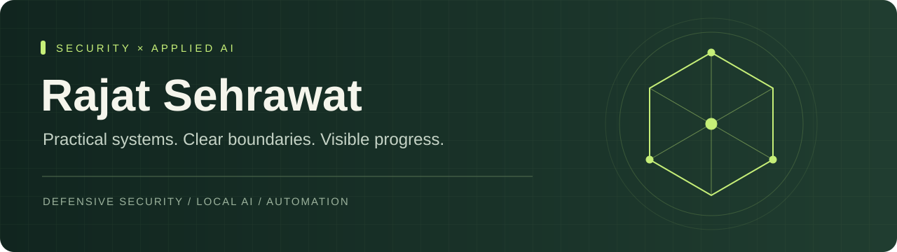

# Rajat Sehrawat
### Cybersecurity · Local AI · Practical automation

Building systems that are useful, inspectable and designed around clear security boundaries.

---

I work in cybersecurity and am developing projects in AI reception, trading research and offline robotics. My current focus is connecting applied AI to real workflows while documenting what works, what fails and what still needs validation.

### Project lab · prototypes in development

**Sentinel Triage** — explainable authentication-event detection with reproducible fixtures.  
**Frontdesk Local** — local knowledge retrieval for an AI receptionist, with human escalation.  
**Trading Research Desk** — a paper-only research workbench that makes costs and drawdown visible.  
**Ghost Companion** — an offline robot concept with consent-aware family knowledge and an ESP32-S3 device layer.  
**Sehrawat Solutions** — an IT and digital-services venture in development.

### How I approach engineering

- Start with a reproducible problem and a small working implementation.
- Make security assumptions, failure modes and limitations explicit.
- Separate simulated results from measured deployment evidence.
- Keep private information out of public demos.

### Current direction

Cybersecurity and applied AI roles where I can build, investigate and improve practical systems.

GitHub: https://github.com/rajatsehrawat0. Project links will be added as repositories are released. These projects are prototypes; production experience and certifications are not implied.
